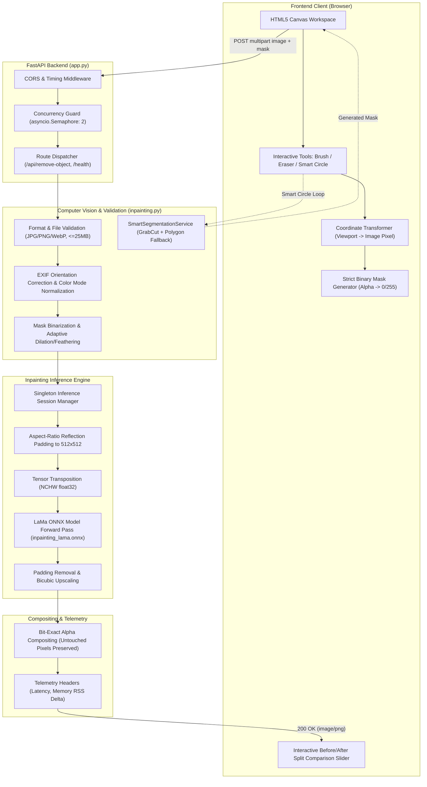

# AI-Powered Photo Editing Assistant

An asynchronous, deep-learning-powered photo cleanup workstation that removes unwanted objects, photobombers, power lines, watermarks, and blemishes using state-of-the-art AI inpainting.

Built with an interactive HTML5 Canvas frontend and a high-performance Python FastAPI backend, the system normalizes user brush strokes into strict binary masks, executes deep generative reconstruction (via a local offline LaMa ONNX model or pluggable cloud providers), and recomposites backgrounds with bit-exact preservation of unmasked regions.

---

## Technical Documentation Quick Links

For comprehensive, review-grade technical documentation, please refer to:
- [Testing & Quality Assurance Documentation](docs/TESTING.md) — 53-test automated test catalog, testing strategy, and empirical pytest results.
- [Error Boundary & Exception Handling Architecture](docs/ERROR_HANDLING.md) — Frontend and backend error boundary catalog, status code mappings, and failure recovery behaviors.

---

## 1. System Architecture

The application implements a non-destructive, streaming pipeline:
```
┌────────────────────────────────────────────────────────┐
│                   Frontend (Browser)                   │
│   HTML5 Canvas Workstation • Brush Tooling • script.js │
└───────────────────────────┬────────────────────────────┘
                            │ POST /api/remove-object
                            │ (multipart image + mask)
                            ▼
┌────────────────────────────────────────────────────────┐
│               FastAPI Backend (app.py)                 │
│    MIME Validation • Size Limits (25MB) • Concurrency  │
└───────────────────────────┬────────────────────────────┘
                            │
                            ▼
┌────────────────────────────────────────────────────────┐
│             Mask Processing (inpainting.py)            │
│   Binarization (>50->255) • Dilation • Feathering      │
└───────────────────────────┬────────────────────────────┘
                            │
                            ▼
┌────────────────────────────────────────────────────────┐
│           LaMa ONNX Neural Inference Engine            │
│   • 512x512 Reflection Padding (Aspect Preserved)      │
│   • ONNX Runtime CPU Execution Provider (Optimized)    │
└───────────────────────────┬────────────────────────────┘
                            │
                            ▼
┌────────────────────────────────────────────────────────┐
│             Post-Processing & Compositing              │
│   Unpadding • Bicubic Resize • Bit-Exact Blending      │
└───────────────────────────┬────────────────────────────┘
                            │ 200 OK (image/png) + Telemetry Headers
                            ▼
┌────────────────────────────────────────────────────────┐
│                    Frontend Result                     │
│    Rendered to Canvas • Interactive Comparison Slider  │
└────────────────────────────────────────────────────────┘
```

### Mermaid Architecture Diagram



### Module Responsibilities

| Module | Primary Responsibility |
|---|---|
| `app.py` | FastAPI server entrypoint. Manages routing, timing middleware, process RSS memory telemetry, concurrency throttling semaphore (`asyncio.Semaphore(2)`), and single-page application static file delivery. |
| `inpainting.py` | Core computer vision and deep learning pipeline. Houses `MaskService` (EXIF orientation, binarization, adaptive morphological dilation and feathering, bit-exact alpha compositing), `LamaInpaintingProvider` (ONNX session lifecycle, reflection padding, tensor conversions), and `SmartSegmentationService` (GrabCut interactive polygon segmentation). |
| `script.js` | Browser-side application engine. Implements the HTML5 Canvas drawing workstation, subpixel coordinate projection between mouse events and image dimensions, freehand brush/eraser strokes, smart circle vector guides, undo/redo history, split comparison slider, and asynchronous API communication. |
| `auth.js` | Client-side authentication service. Coordinates user authentication via Supabase JS SDK with automatic fallback to browser `localStorage` for offline demonstration mode. |
| `inpainting_lama.onnx` | Embedded pre-trained Large Mask Inpainting (LaMa) ONNX deep neural network model weights ($88.3 \text{ MB}$). Operates entirely locally on CPU without cloud transmission. |
| `run.py` / `run.bat` | Cross-platform and Windows one-click lifecycle launchers. Verifies port availability, activates the virtual environment, validates model readiness, and launches the browser. |

---

## 2. API Reference

Comprehensive reference for all routes implemented in `app.py`.

### 2.1 Health & Diagnostic Status

- **HTTP Method**: `GET`
- **Endpoint**: `/api/health`
- **Aliases**: `/health`, `/api/status`
- **Purpose**: System health check returning provider configuration, neural model loading state, and process memory consumption.
- **Request Content-Type**: None
- **Parameters**: None
- **Response Content-Type**: `application/json`
- **Response Headers**:
  - `X-Process-Time-Ms`: Server execution duration in ms.
  - `Server-Timing`: W3C timing header.

#### Example Request
```bash
curl -X GET http://127.0.0.1:8000/api/health
```

#### Successful Response (`200 OK`)
```json
{
  "status": "ok",
  "model": "ready",
  "model_state": "ready",
  "provider": "lama",
  "app": "ai-object-remover",
  "provider_configured": true,
  "memory_rss_mb": 248.52
}
```

#### Error Response (`200 OK` with degraded status)
```json
{
  "status": "error",
  "model": "not_ready",
  "model_state": "missing",
  "provider": "lama",
  "app": "ai-object-remover",
  "provider_configured": true,
  "memory_rss_mb": 110.14,
  "error": "Model file 'inpainting_lama.onnx' is missing from models directory."
}
```

---

### 2.2 Client Authentication Configuration

- **HTTP Method**: `GET`
- **Endpoint**: `/api/auth/config`
- **Purpose**: Returns public client authentication parameters (Supabase project URL and anonymous key) for client-side SDK initialization.
- **Request Content-Type**: None
- **Parameters**: None
- **Response Content-Type**: `application/json`

#### Example Request
```bash
curl -X GET http://127.0.0.1:8000/api/auth/config
```

#### Successful Response (`200 OK`)
```json
{
  "supabase_url": "",
  "supabase_anon_key": ""
}
```
*(Note: Returns empty strings when unconfigured, instructing frontend to use offline demo mode).*

---

### 2.3 Remove Object (AI Inpainting)

- **HTTP Method**: `POST`
- **Endpoint**: `/api/remove-object`
- **Aliases**: `/remove-object`, `/api/inpaint`
- **Purpose**: Removes unwanted objects from an image using the local LaMa ONNX deep neural network model or configured cloud provider.
- **Request Content-Type**: `multipart/form-data`
- **Required Parameters**:
  - `image` (`UploadFile`): Binary image file (JPG, JPEG, PNG, or WebP). Maximum size: $25\text{ MB}$.
  - `mask` (`UploadFile`): Binary mask file (PNG or JPG). Pixels set to white ($255$) indicate regions to be removed and synthesized; black ($0$) indicates regions to keep intact.
- **Optional Parameters**:
  - `prompt` (`string`, form-field): Optional text prompt guiding background synthesis (default: `"seamless background fill, photorealistic, clean texture"`).
- **Response Content-Type**: `image/png`
- **Response Headers**:
  - `Content-Type: image/png`
  - `X-Original-Width: <int>` — Source width in pixels.
  - `X-Original-Height: <int>` — Source height in pixels.
  - `X-Mask-Coverage: <float>%` — Percentage of total image area marked for removal.
  - `X-Process-Time-Ms: <float>` — Total server request processing latency in ms.
  - `X-Inference-Time-Ms: <float>` — Neural network forward pass latency in ms.
  - `X-Memory-Rss-Mb: <float>` — Process resident memory in MB.
  - `X-Memory-Delta-Mb: <float>` — Memory variation during execution in MB.
  - `Server-Timing: total;dur=<ms>, inpaint;dur=<ms>`
  - `Cache-Control: no-store, no-cache, must-revalidate`

#### Example Request
```bash
curl -X POST http://127.0.0.1:8000/api/remove-object \
  -F "image=@photo.jpg;type=image/jpeg" \
  -F "mask=@mask.png;type=image/png" \
  -F "prompt=seamless background fill" \
  --output result.png
```

#### Successful Response (`200 OK`)
Binary PNG stream representing the reconstructed photo at original resolution.

#### Possible Error Responses
| HTTP Status | Error Code | Trigger Condition | Example Response Body |
|---|---|---|---|
| `400 Bad Request` | `EMPTY_IMAGE` | Zero-byte image upload | `{"detail": {"error": "EMPTY_IMAGE", "message": "The uploaded image file is empty."}}` |
| `400 Bad Request` | `EMPTY_MASK` | Zero-byte mask upload | `{"detail": {"error": "EMPTY_MASK", "message": "The uploaded mask file is empty."}}` |
| `400 Bad Request` | `IMAGE_DECODE_ERROR` | Non-image binary or corrupted bytes | `{"detail": {"error": "IMAGE_DECODE_ERROR", "message": "Failed to decode image data..."}}` |
| `413 Payload Too Large` | `FILE_TOO_LARGE` | Upload exceeds 25MB threshold | `{"detail": {"error": "FILE_TOO_LARGE", "message": "Image size exceeds 25MB limit..."}}` |
| `415 Unsupported Media` | `UNSUPPORTED_FORMAT` | Format is not JPG, PNG, or WebP (e.g. GIF) | `{"detail": {"error": "UNSUPPORTED_FORMAT", "message": "Please upload a JPG, JPEG or PNG image."}}` |
| `422 Unprocessable Content` | `EMPTY_SELECTION` | Mask is entirely black (0 pixels selected) | `{"detail": {"error": "EMPTY_SELECTION", "message": "Please select the object you want to remove."}}` |
| `422 Unprocessable Content` | Missing Parameter | Missing `image` or `mask` multipart fields | `{"detail": [{"loc": ["body", "image"], "msg": "Field required", "type": "missing"}]}` |
| `502 Bad Gateway` | `AI_INPAINTING_ERROR` | ONNX Runtime inference engine failure | `{"detail": {"error": "AI_INPAINTING_ERROR", "message": "LaMa AI inpainting engine error: ..."}}` |
| `503 Service Unavailable` | `AI_PROVIDER_NOT_CONFIGURED` | Model file missing or provider unconfigured | `{"detail": {"error": "AI_PROVIDER_NOT_CONFIGURED", "message": "AI service configuration is incomplete...", "provider": "lama"}}` |
| `504 Gateway Timeout` | `PROVIDER_TIMEOUT` | Upstream or local worker execution timed out | `{"detail": {"error": "PROVIDER_TIMEOUT", "message": "Unable to connect to the AI service..."}}` |
| `500 Internal Error` | `INTERNAL_SERVER_ERROR` | Uncaught server exception | `{"detail": {"error": "INTERNAL_SERVER_ERROR", "message": "Unexpected server error: ..."}}` |

---

### 2.4 Smart Circle Segmentation

- **HTTP Method**: `POST`
- **Endpoint**: `/api/smart-circle-segment`
- **Purpose**: Generates an object silhouette mask from a user-drawn loop using OpenCV GrabCut foreground extraction.
- **Request Content-Type**: `multipart/form-data`
- **Required Parameters**:
  - `image` (`UploadFile`): Source image file.
  - `points` (`string`, Form): Serialized JSON array of polygon vertices, e.g. `'[{"x": 100, "y": 100}, {"x": 200, "y": 100}, {"x": 150, "y": 200}]'`. Minimum 3 points required.
- **Optional Parameters**:
  - `mode` (`string`, Form): Segmentation mode (`'smart_object'` for GrabCut segmentation or `'fill_interior'` for direct polygon fill).
- **Response Content-Type**: `image/png` (8-bit binary mask where foreground is white and background is transparent).

#### Example Request
```bash
curl -X POST http://127.0.0.1:8000/api/smart-circle-segment \
  -F "image=@photo.png;type=image/png" \
  -F 'points=[{"x":100,"y":100},{"x":200,"y":100},{"x":150,"y":200}]' \
  -F "mode=smart_object" \
  --output mask.png
```

#### Successful Response (`200 OK`)
Binary PNG mask image file.

#### Possible Error Responses
- `400 Bad Request` (`INVALID_POINTS`): Malformed JSON coordinates string.
- `400 Bad Request` (`INSUFFICIENT_POINTS`): Fewer than 3 points provided.
- `400 Bad Request` (`EMPTY_IMAGE`): Zero-byte image upload.
- `500 Internal Server Error` (`SEGMENTATION_ERROR`): GrabCut algorithmic processing error.

---

### 2.5 Static Web Application Routes

| Endpoint | Method | Response MIME | Description |
|---|---|---|---|
| `/` | `GET` | `text/html` | Serves the single-page editor workspace (`index.html`). |
| `/index.html` | `GET` | `text/html` | Direct URL alias for index file. |
| `/style.css` | `GET` | `text/css` | Studio design system styling and theme tokens. |
| `/script.js` | `GET` | `application/javascript` | Frontend canvas controller and API integration client. |
| `/auth.js` | `GET` | `application/javascript` | Client authentication and session manager. |
| `/{filename}.jpg` | `GET` | `image/jpeg` | High-resolution demonstration before/after photography assets. |
| `/assets/{filename}` | `GET` | Inferred | Static assets and icon resources. |

---

## 3. Database Architecture & Absence Statement

> **Notice: This project currently does not use a database.**

### 3.1 Architectural Rationale

The system is deliberately designed as a **stateless, zero-persistence privacy workstation**:

1. **In-Memory Streaming Pipeline**: All photo decoding, binary mask rasterization, neural network inference, and bit-exact compositing take place entirely within ephemeral memory buffers (`io.BytesIO`, `numpy.ndarray`, `PIL.Image.Image`).
2. **Zero Disk Storage**: Neither uploaded source photographs nor AI-synthesized output images are written to server disks or database tables. When the HTTP request lifecycle terminates, image arrays are cleared by Python's garbage collector.
3. **Privacy & Confidentiality**: Users can edit sensitive personal photos, academic figures, or proprietary images with mathematical confidence that no data is retained, stored, or indexed on the backend.
4. **Client-Side State & Session Management**:
   - Canvas history, active image layers, and multi-step Undo/Redo stacks are maintained in browser RAM via the HTML5 Canvas 2D API.
   - Authentication sessions are handled client-side via the Supabase JavaScript SDK, with graceful fallback to browser `localStorage` (`ai_photo_studio_auth_session`) when operating offline.
   - The backend exposes only the stateless configuration endpoint `/api/auth/config` and maintains no user tables, credentials, or session databases.

No SQL tables, NoSQL collections, or ORM models exist in the codebase.

---

## 4. Test Execution Guide

Follow these exact steps to set up the environment and run the test suite.

### 4.1 Environment Setup

1. **Clone or Navigate to the Workspace**:
   ```bash
   cd c:\Users\user\Desktop\ai
   ```

2. **Create and Activate a Virtual Environment**:
   - **Windows (PowerShell)**:
     ```powershell
     python -m venv .venv
     .\.venv\Scripts\Activate.ps1
     ```
   - **Linux / macOS**:
     ```bash
     python3 -m venv .venv
     source .venv/bin/activate
     ```

3. **Install Dependencies**:
   ```bash
   pip install -r ai-object-remover/requirements.txt
   ```

4. **Acquire AI Inpainting Model Weights (`inpainting_lama.onnx`)**:
   The local neural inpainting engine utilizes the LaMa ONNX checkpoint ($88.3\text{ MB}$).
   
   - **Option A (Automated Python Downloader - Recommended)**:
     ```bash
     python ai-object-remover/download_model.py
     ```
     This automatically downloads `inpainting_lama_2025jan.onnx` from Hugging Face OpenCV mirror, verifies the SHA-256 hash (`7df918ac...`), and places it at `inpainting_lama.onnx`.

   - **Option B (Git LFS)**:
     If cloning the repository with Git Large File Storage configured:
     ```bash
     git lfs install
     git lfs pull
     ```

   - **Option C (Manual Download)**:
     Download from [Hugging Face OpenCV LaMa Mirror](https://huggingface.co/opencv/inpainting_lama/resolve/main/inpainting_lama_2025jan.onnx) and save as `ai-object-remover/inpainting_lama.onnx`.

### 4.2 Running the Application

- **One-Click Startup (Windows)**:
  ```cmd
  run.bat
  ```
- **Cross-Platform Startup**:
  ```bash
  python app.py
  ```
  The server starts on `http://127.0.0.1:8000`.

### 4.3 Running the Test Suite

Execute the following commands from the workspace root (`c:\Users\user\Desktop\ai`):

- **Run all automated tests**:
  ```powershell
  python -m pytest ai-object-remover/tests -v
  ```

- **Run an individual test file**:
  ```powershell
  # API endpoint tests only
  python -m pytest ai-object-remover/tests/test_api.py -v

  # Inpainting and CV module tests only
  python -m pytest ai-object-remover/tests/test_inpainting.py -v
  ```

- **Run tests with short tracebacks**:
  ```powershell
  python -m pytest ai-object-remover/tests -v --tb=short
  ```

---

## 5. Test Results

The full automated test suite was executed against the active codebase using the local offline LaMa ONNX model on CPU.

### Empirical Test Output
```
============================= test session starts =============================
platform win32 -- Python 3.12.4, pytest-7.4.4, pluggy-1.0.0
rootdir: C:\Users\user\Desktop\ai
plugins: anyio-4.2.0
collected 53 items

ai-object-remover/tests/test_api.py ..........................           [ 49%]
ai-object-remover/tests/test_inpainting.py ...........................   [100%]

======================= 53 passed, 3 warnings in 34.61s =======================
```

### Metrics Summary
- **Total Tests**: **53**
- **Passed**: **53**
- **Failed**: **0**
- **Skipped**: **0**
- **Execution Time**: **34.61 seconds**
- **Pass Rate**: **100.0%**

Detailed test descriptions, inputs, expected outputs, and test IDs (`TC-API-001` through `TC-API-026` and `TC-INP-001` through `TC-INP-027`) are documented in [docs/TESTING.md](docs/TESTING.md).

---

## 6. Project Structure

```
ai/
├── app.py                     # Workspace root launcher (delegates to project)
├── run.bat                    # Workspace root batch launcher
├── pyrightconfig.json         # Python language server configuration
├── docs/                      # Global documentation mirror
│   ├── TESTING.md             # Complete unit and API test case catalog
│   └── ERROR_HANDLING.md      # Comprehensive error boundary specification
│
└── ai-object-remover/         # Core application directory
    ├── app.py                 # FastAPI backend (endpoints, middleware, telemetry)
    ├── inpainting.py          # CV pipeline, MaskService, LaMa ONNX engine, GrabCut
    ├── inpainting_lama.onnx   # Offline LaMa neural net model weights (88.3MB)
    ├── download_model.py      # Automated model asset downloader & SHA-256 verifier
    ├── .gitattributes         # Git LFS configuration for neural net weights
    ├── script.js              # HTML5 Canvas workstation & API client
    ├── auth.js                # Client authentication controller & local fallback
    ├── style.css              # Responsive UI styles and theme tokens
    ├── index.html             # Studio single-page workspace interface
    ├── requirements.txt       # Pinned runtime dependencies
    ├── run.py                 # Lifecycle runner with port and environment detection
    ├── run.bat                # Windows one-click batch launcher
    ├── README.md              # Project documentation and API reference
    ├── docs/
    │   ├── TESTING.md         # Unit testing and test case catalog
    │   └── ERROR_HANDLING.md  # Error boundary documentation
    └── tests/
        ├── __init__.py        # Test package marker
        ├── test_api.py        # 26 automated integration & API tests
        └── test_inpainting.py # 27 automated unit tests for CV & LaMa logic
```

---

## 7. License

MIT License. Free for academic, personal, and commercial usage.
